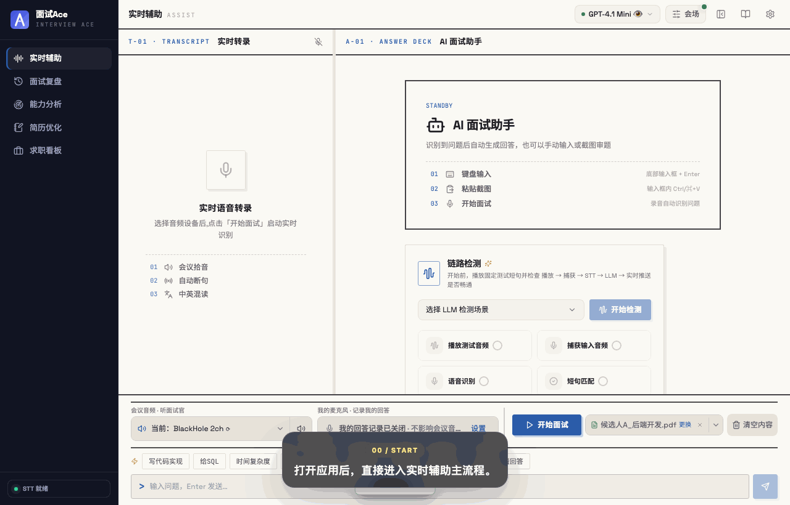
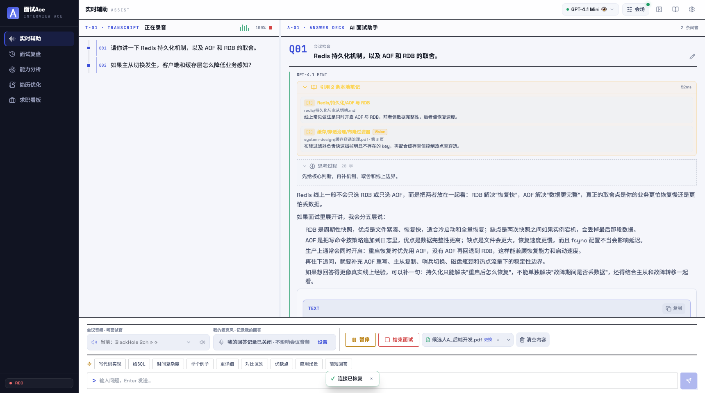
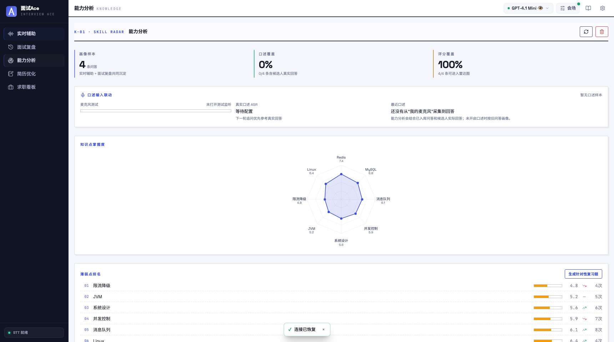
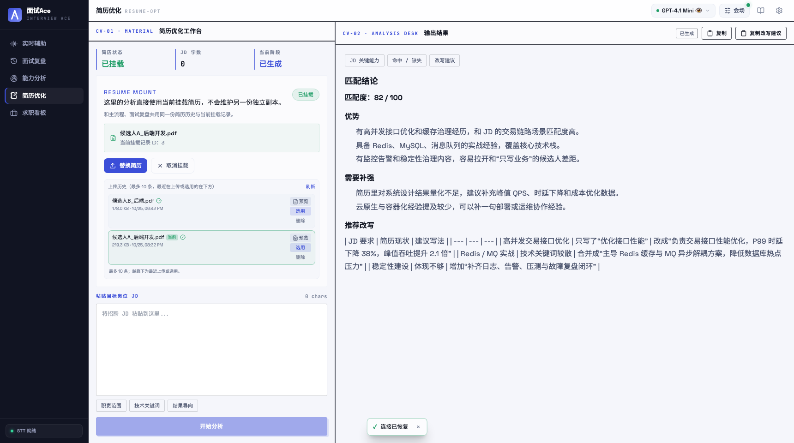
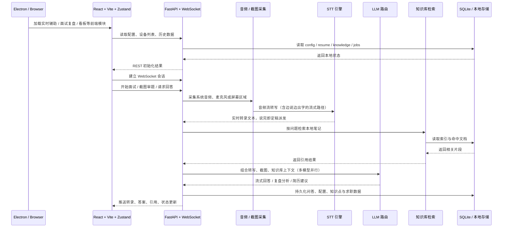

# 面试Ace InterviewAce

实时听题，自动生成专业面试回答。把它理解成一个开着就能用的面试搭档：你负责听题和临场反应，它负责转写、审题、答题——面试官话音落下的同时，答案已经开始生成；卡壳的时候，还能把问答框折叠成一条轻量悬浮窗挂在屏幕角落。

面向真实技术面试全流程：实时转写支持四种识别引擎（本地 Whisper / 豆包 / 通用 ASR / 阿里千问），说完即定稿派发；自己的回答也会被麦克风转写记录，供复盘和上下文参考。Electron 桌面端提供屏幕共享隐身、Boss Key、托盘和悬浮问答窗，绝大多数常见面试软件场景下都能避开共享检测，但不同软件策略不同，请务必自行充分实测。

<p align="center">
  
  
  
  
  
  
  
</p>

<p align="center">
  <video src="docs/screenshots/assist-demo.webm" poster="docs/screenshots/assist-demo-poster.png" controls muted width="100%"></video>
</p>

<p align="center">
  
</p>

## 下载安装

打包好的桌面版直接见 **[GitHub Releases](https://github.com/lhc75/-Ace/releases)**（当前最新：**v1.1.0**，macOS Apple Silicon）。

下载 `InterviewAce-arm64.dmg`，打开后将「面试Ace」拖入「应用程序」即可。首次启动如提示"已损坏/无法验证开发者"，在 系统设置 → 隐私与安全性 中允许，或执行 `xattr -cr /Applications/面试Ace.app`。

**应用内升级**：桌面版会自动检测新版本（启动后 + 每 6 小时，GitHub 优先、Gitee 镜像兜底），发现更新时在右下角弹出提示，点「立即升级」自动下载并打开安装包；也可在 设置 → 常用 → 关于与更新 中手动检查或查看当前版本。

> 本仓库仅托管后端源码；前端与桌面端源码未公开，开箱即用的完整应用请从 Releases 下载。

## 为什么值得试

> 不是"问答玩具"，而是围绕技术面试现场节奏设计的完整链路：听题 → 识别问题 → 生成答案 → 引用你的笔记 → 记录你的回答 → 面试后复盘沉淀。桌面端把共享隐身和悬浮窗纳入主流程，面试之外还能管理简历、JD 和 Offer。

| 场景 | 能力 |
| --- | --- |
| **实时面试** | 四引擎转写、边说边出字、说完即答题、多模型并行生成、思考过程展示 |
| **卡壳补位** | 截图审题、识图模型分析、联网搜索、知识库引用本地笔记 |
| **个人材料接入** | 简历上传与摘要、JD 对照优化，让答案贴近你的真实经历 |
| **桌面端体验** | 屏幕共享隐身、Boss Key、托盘、悬浮问答窗、跟随鼠标、应用内检查更新 |
| **复盘与提升** | 双音轨问答记录、ASR 纠错、逐题分析、能力画像、求职看板 |

## 面试主流程

1. 选择系统音频（对方声音）或麦克风，点击开始。
2. 左侧实时转写持续落字——开启「面试官实时流式转写」后，对方边说边出字；说完的瞬间整句定稿并立即派发答题。
3. 右侧答案区按当前模型配置流式生成正式回答，可同时并行多个模型对比取舍。
4. 需要审图时粘贴截图，把题目、代码片段或页面内容交给识图模型分析。
5. 开启知识库后，答案上方显示引用角标，关联你的本地笔记或资料。
6. 空间紧张时按 `⌘⇧J / Ctrl+Shift+J` 折叠左侧转录面板，让回答区铺满。
7. 桌面模式下配合悬浮问答窗、Boss Key 和共享隐身使用；笔试场景可切换笔试模式，悬浮窗逐题作答。

## 主界面速览

<p align="center">
  
</p>

## 关键能力雷达

<table>
  <tr>
    <td width="50%" valign="top">
      <h3>实时辅助</h3>
      <p>四种 STT 引擎（Whisper / 豆包 / 通用 ASR / 阿里千问）、边说边出字的流式转写、说完即定稿派发、多模型并行回答、截图审题、知识库引用、模型健康与 Token 统计。</p>
    </td>
    <td width="50%" valign="top">
      <h3>桌面协同</h3>
      <p>Electron 端提供屏幕共享隐身（系统截图同样录不到悬浮窗）、Boss Key、托盘、悬浮问答窗和全局快捷键，尽量降低主界面暴露。</p>
    </td>
  </tr>
  <tr>
    <td width="50%" valign="top">
      <h3>训练与复盘</h3>
      <p>面试官与你的声音双音轨转写、LLM 自动纠正识别错误、逐题分析与整场总结、知识点能力画像与薄弱点趋势。</p>
    </td>
    <td width="50%" valign="top">
      <h3>求职材料</h3>
      <p>简历上传与摘要、JD 对照优化、求职看板（表格 / 看板双视图、拖拽排序）、Offer 对比，把面试前后动作收在一个工具里。</p>
    </td>
  </tr>
</table>

## 模块画廊

<table>
  <tr>
    <td width="50%"></td>
    <td width="50%"></td>
  </tr>
  <tr>
    <td align="center"><strong>能力分析</strong><br /><sub>知识点趋势、问答沉淀、薄弱项复盘</sub></td>
    <td align="center"><strong>简历优化</strong><br /><sub>把简历和 JD 放到一起，输出更像"能投出去"的版本</sub></td>
  </tr>
</table>

## 功能总览

| 模块 | 现在能做什么 |
| --- | --- |
| **实时辅助** | ASR 转写（四引擎）→ 问题识别 → 多模型并行回答 → 截图审题 / 联网搜索 / 知识库引用 |
| **面试复盘** | 录制真实问答双音轨、ASR 自动纠错、逐题分析、整场总结 |
| **知识库** | 上传 `.md` / `.txt` / `.log` / `.docx` / `.pdf`，支持检索测试、最近命中和回答引用角标 |
| **能力分析** | 知识点标签、历史问答记录、薄弱点趋势 |
| **简历优化** | 上传简历，对照目标 JD 给出匹配度评估、优化建议和改写方向 |
| **求职看板** | 表格 / 看板双视图、状态标签、拖拽排序、Offer 对比 |
| **设置中心** | 多模型管理、推理参数、STT 引擎与流式开关、主题、偏好、快捷键、截图区域 |

## 技术结构



### 技术栈

| 层 | 技术 |
| --- | --- |
| **前端** | React 18 · TypeScript · Vite · Zustand · Tailwind CSS |
| **后端** | Python 3.10+ · FastAPI · Uvicorn · WebSocket |
| **语音识别** | faster-whisper · 豆包 (Volcengine) · 通用 ASR (OpenAI-compatible) · 阿里千问流式 |
| **LLM** | OpenAI 兼容接口 · 多模型并行 · Think 推理 · 识图 · 联网搜索 |
| **存储** | SQLite · 本地简历历史 · 知识库索引 |
| **桌面** | Electron |

## 快速开始（后端）

本仓库只包含后端服务（`backend/`）。日常使用的完整桌面应用请直接从 Releases 下载；以下步骤适用于想单独运行后端 API 的场景。

### 1. 准备环境

- Python `3.10+`

```bash
git clone https://github.com/lhc75/-Ace.git
cd ./-Ace

pip install -r backend/requirements.txt
cp backend/config.example.json backend/config.json
```

### 2. 配置模型（LLM）

所有答题模型都走 **OpenAI 兼容接口**（`POST {api_base_url}/chat/completions`），任一兼容该格式的服务都能接入。编辑 `backend/config.json` 的 `models` 数组（可配多个并行），`active_model` 是默认选中的下标（从 0 开始）。

两个常用厂商的完整示例：

#### DeepSeek（推荐，便宜且快）

1. 到 [platform.deepseek.com/api_keys](https://platform.deepseek.com/api-keys) 注册并创建 API Key（`sk-` 开头）。
2. 填入：

```json
{
  "name": "DeepSeek-V3",
  "api_base_url": "https://api.deepseek.com",
  "api_key": "sk-xxxxxxxxxxxx",
  "model": "deepseek-chat",
  "supports_think": true,
  "supports_vision": false,
  "enabled": true
}
```

- `model` 也可填 `deepseek-reasoner`（推理更强的 R 系列）。
- 想让答案联网检索：同一模型里再开 `web_search_enabled`，`web_search_api_base_url` 填 `https://api.deepseek.com`，`web_search_api_key` 单独申请（与模型 Key 不共用）。

#### 通义千问 Qwen（阿里百炼）

1. 到 [dashscope.console.aliyun.com/apiKey](https://dashscope.console.aliyun.com/apiKey) 开通百炼并创建 API Key。
2. 填入：

```json
{
  "name": "Qwen-Plus",
  "api_base_url": "https://dashscope.aliyuncs.com/compatible-mode/v1",
  "api_key": "sk-xxxxxxxxxxxx",
  "model": "qwen-plus",
  "supports_think": false,
  "supports_vision": true,
  "enabled": true
}
```

- `model` 可选 `qwen-plus` / `qwen-turbo` / `qwen-max` 等；需要截图审题就把 `supports_vision` 设为 `true` 并选用多模态型号（如 `qwen-vl-max` 或带视觉能力的 qwen 系列）。
- 注意 Base URL 必须带 `/compatible-mode/v1` 后缀，这是百炼的 OpenAI 兼容入口。

其他兼容厂商（OpenAI `https://api.openai.com/v1`、智谱 GLM `https://open.bigmodel.cn/api/paas/v4`、本地 Ollama `http://localhost:11434/v1` 等）按同一格式填入即可。

### 3. 配置语音识别（STT）

四选一（完整桌面版的图形界面里可直接切换；纯后端运行时编辑 `config.json`）：

| 引擎 | 说明 | 需要什么 |
| --- | --- | --- |
| **Whisper（本地）** | 默认。首次使用自动下载模型，断网可用 | 无 Key；模型大小可选 tiny→large-v3 |
| **阿里千问流式** | 真·服务端流式，边说边出字体验最好 | 百炼 API Key + 模型 `qwen-audio-3.1-asr-flash-streaming` |
| **豆包（火山引擎）** | 流式识别 | 火山引擎语音服务凭证 |
| **通用 ASR** | 接你自己部署或第三方兼容服务 | 见下方部署要求 |

#### 通用 ASR 部署要求

「通用 ASR」对接 **OpenAI 兼容的语音转写接口**，你的服务只需满足：

- **接口路径**：`POST {Base URL}/audio/transcriptions`
- **请求格式**：`multipart/form-data`，文件字段名 `file`（16kHz 单声道 WAV），表单字段 `model`、`response_format=json`
- **返回格式**：JSON，识别文本放在 `text` / `transcript` / `result` / `content` 任一字段（`result` 可以是嵌套对象）
- **鉴权**：请求头 `Authorization: Bearer <API Key>`；本地服务不要 Key 就把 Key 留空
- **自定义请求头**：支持附加自定义 Header（JSON 或每行 `Key: Value`），用于特殊网关鉴权

对应 `config.json` 字段为 `generic_stt_api_base_url` / `generic_stt_api_key` / `generic_stt_model` / `generic_stt_custom_headers`。

可直接使用的开源服务（任选其一）：

```bash
# faster-whisper-server（OpenAI 兼容，支持 CUDA / CPU，最简单）
docker run -d -p 8000:8000 --gpus all fedirz/faster-whisper-server:latest-cuda
# Base URL 填 http://127.0.0.1:8000/v1 ，模型名填 small（或你拉取的 whisper 模型）

# FunASR（阿里开源，中文效果好，需自行包一层 OpenAI 兼容接口）
```

性能要求（重要）：

- 通用 ASR 是**整段批量接口**，没有服务端流式事件。开启「面试官实时流式转写」后，本助手会每隔约 1.2 秒（`generic_stt_streaming_interval_ms`，800–10000ms 可调）把当前语句整体重转写一次来模拟流式效果——**识别速度必须明显快于实时**，否则长句会越积越慢。
- 因此**强烈建议 GPU 部署**（如 faster-whisper-server 的 CUDA 镜像 + `small`/`medium` 模型）。纯 CPU 只适合短句场景，或把重转写间隔调大到 3–5 秒。
- 单次请求超时为连接 10 秒 / 读取 60 秒；定稿转写失败会自动降级到本地 Whisper 兜底，interim（进行中行）失败则自动冷却后重试，不影响最终落字。

### 4. 启动后端

```bash
cd backend
python -m uvicorn main:app --host 127.0.0.1 --port 18080
```

默认端口 18080。本地直接跑后端时默认不启用鉴权；设置 `IA_AUTH_ENABLE=1` 或 `IA_AUTH_TOKEN` 后，局域网请求需携带 token。

### 5. 运行测试

```bash
python -m pytest backend/tests -q
```

## 项目结构

```text
interview-assistant/
├── README.md
└── backend/
    ├── main.py            # FastAPI 入口
    ├── api/               # REST / WebSocket 路由
    ├── core/              # 配置、会话、日志、资源调度
    ├── services/          # STT / LLM / 知识库 / 存储 / 复盘分析
    ├── assets/
    ├── scripts/           # 演示数据、回放、验证脚本
    └── tests/             # pytest 测试
```

## 常见问题

- **Whisper 模型下载慢**：可设置 `export HF_ENDPOINT=https://hf-mirror.com`。
- **macOS 下 sounddevice 安装失败**：先执行 `brew install portaudio`。
- **macOS 截图/录音权限**：打开「系统设置 → 隐私与安全性」，为启动本程序的应用（终端、iTerm2 等）开启屏幕录制与麦克风权限，然后完全退出并重新运行。
- **端口冲突**：`uvicorn` 启动时换 `--port 9090` 即可。

## 开源协议与免责

- **协议**：[CC BY-NC 4.0](https://creativecommons.org/licenses/by-nc/4.0/)
- **免责**：项目仅供学习研究，请勿用于学术不端、违规考试或其他不合规场景；使用后果自行承担。
