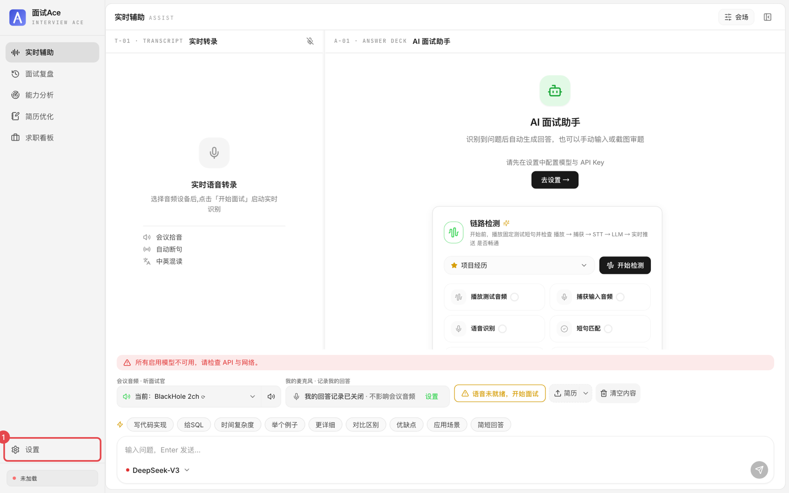
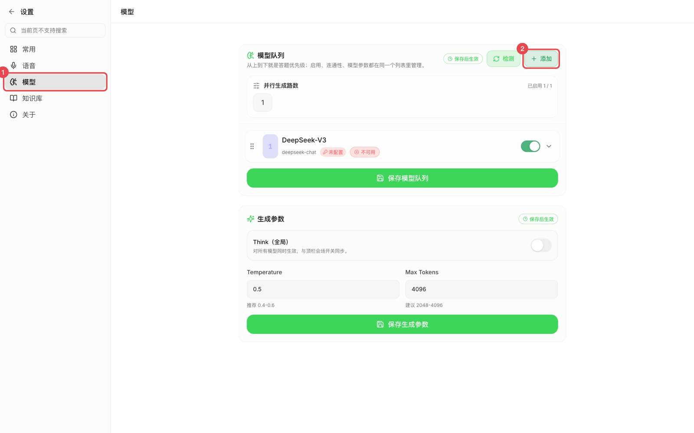
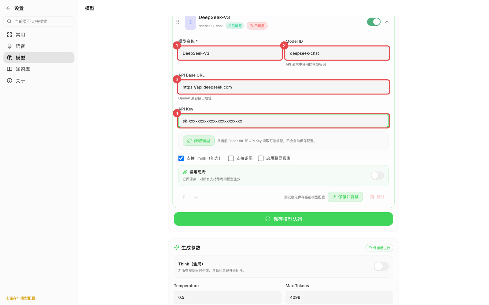
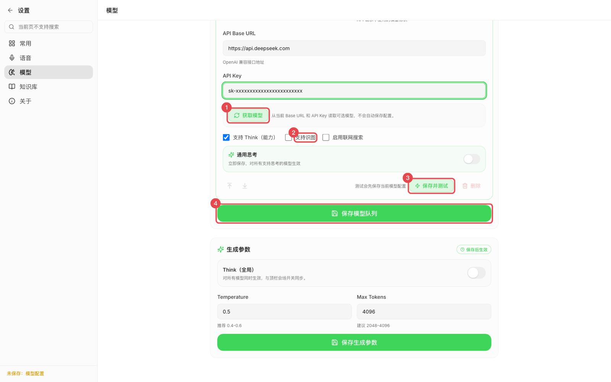
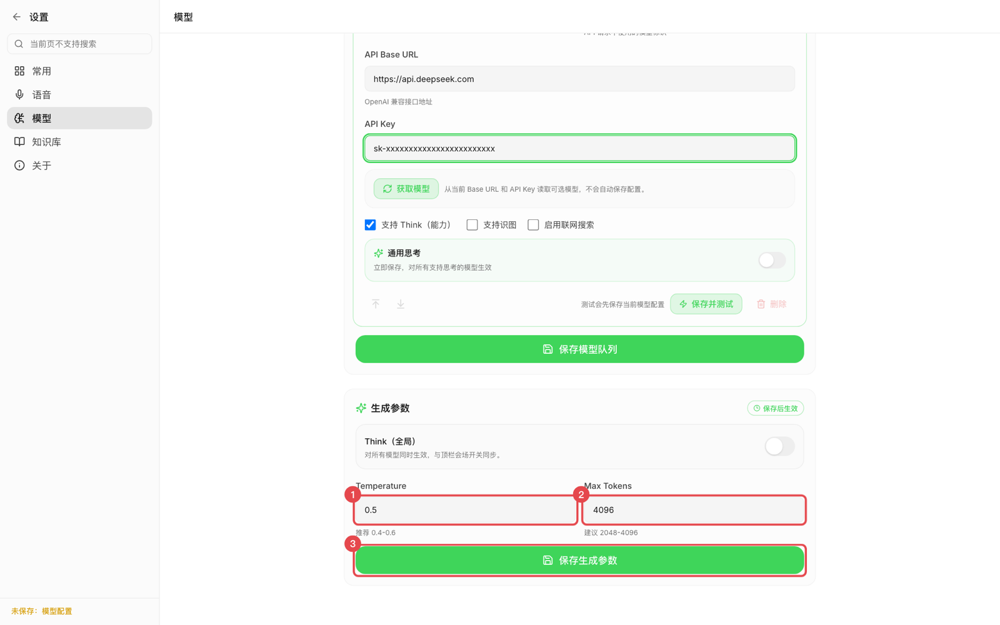
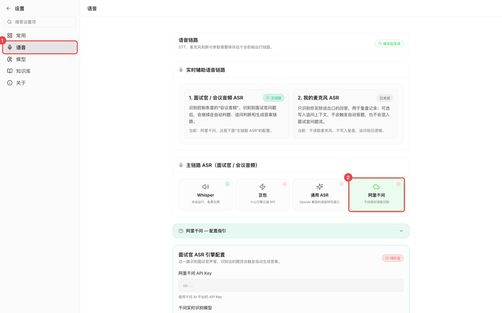
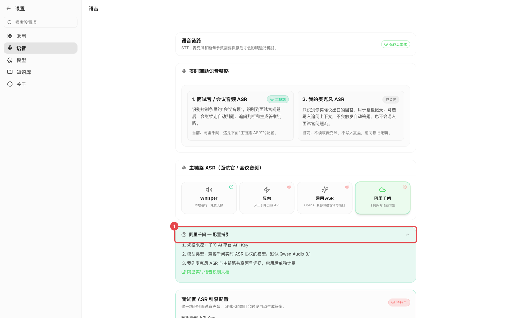
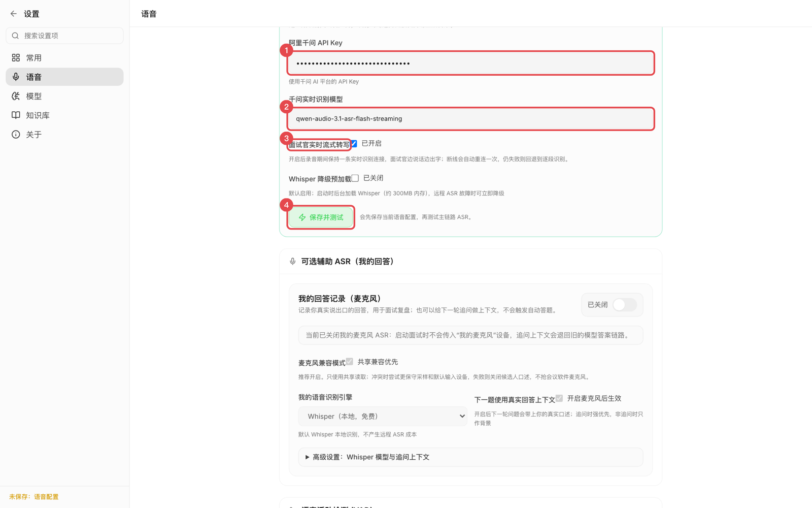
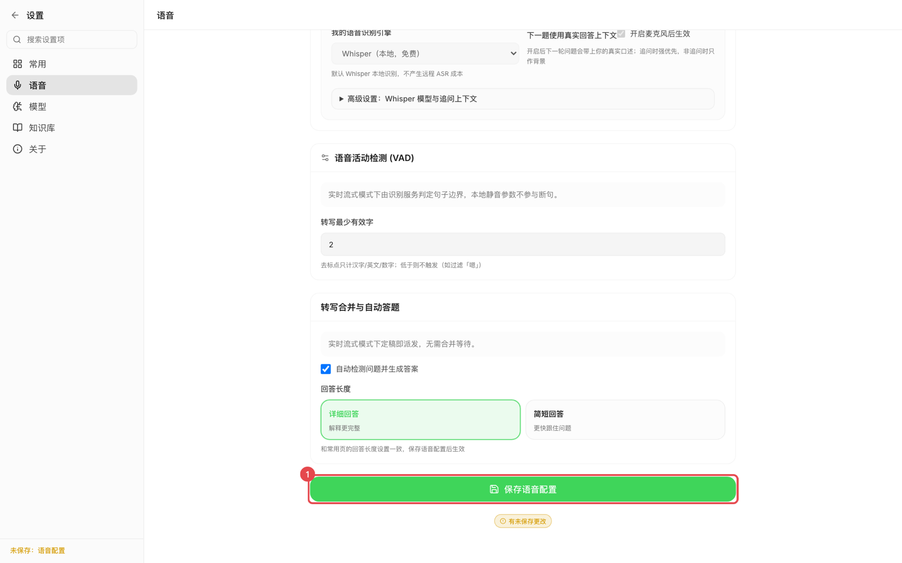

# 客户端 API 配置指南

本文一步一步说明在**面试Ace 桌面客户端**里怎么配置 API：先配答题用的大语言模型，再配语音识别模型。每一步都配了截图，红框和红色数字标出了要操作的位置，数字顺序就是操作顺序。

客户端设置页里填的内容会保存到后端的 `config.json`，和手动编辑配置文件是同一份配置，两种方式任选其一。

> **推荐组合**
> - 答题模型：DeepSeek `deepseek-chat`（便宜、快），或通义千问系列。
> - 语音识别：**阿里千问实时识别 `qwen-audio-3.1-asr-flash-streaming`**，并打开「面试官实时流式转写」，面试官边说边出字，说完立刻答题。

截图里的 Key 都是 `sk-xxxx` 占位符，请换成你自己申请的 Key。

---

## 准备工作：先申请两个 API Key

| 用途 | 去哪里申请 | Key 的样子 |
| --- | --- | --- |
| 答题模型（以 DeepSeek 为例） | <https://platform.deepseek.com/api_keys> | `sk-` 开头 |
| 语音识别（阿里千问实时识别） | 千问 AI 平台：<https://platform.qianwenai.com/home/api-keys> | `sk-ws-` 开头（早期为 `sk-`） |

两个 Key 的详细申请步骤分别在第 1 步和第 6 步。如果答题模型也想用千问，千问 AI 平台的同一个 Key 可以两处都用，只需申请一个。

---

## 第 0 步：打开设置

启动客户端，点击左下角的 **设置**（图中 ①）。

如果还没配置过模型，主界面中间会提示「请先在设置中配置模型与 API Key」，点它下面的 **去设置 →** 也能进入同一个页面。



设置页左侧是分页导航：**常用 / 语音 / 模型 / 知识库 / 关于**。下面先配「模型」，再配「语音」。

---

## 第一部分：配置答题大模型（设置 → 模型）

所有答题模型都走 **OpenAI 兼容接口**（程序会请求 `POST {API Base URL}/chat/completions`），只要厂商提供 OpenAI 兼容地址就能接入。可以添加多个模型，从上到下就是答题优先级。

### 第 1 步：申请大模型 API Key

以 DeepSeek 为例：

1. 打开 <https://platform.deepseek.com/api_keys>，注册并登录。
2. 点击 **创建 API Key**，起个名字（如「面试Ace」）。
3. 复制生成的 Key（`sk-` 开头）并保存好。Key 只在创建时完整显示一次。
4. 账户里需要有余额，否则测试时会报余额不足或 402。

其他厂商的申请地址见下文第 3 步的表格。

### 第 2 步：进入「模型」页，添加一个模型

1. 点击左侧导航的 **模型**（图中 ①）。
2. 点击右上角的 **添加**（图中 ②），列表底部会出现一张新的模型卡片。点卡片右侧的箭头可以展开或收起。

如果列表里已经有一张示例卡片（比如 `Example-Model`），也可以直接展开它修改，不必新增。



### 第 3 步：填写模型的四个字段

展开卡片后，依次填写：

| 序号 | 界面字段 | 填什么 | DeepSeek 示例 |
| --- | --- | --- | --- |
| ① | 模型名称 * | 界面上显示的名字，随便起，方便自己识别 | `DeepSeek-V3` |
| ② | Model ID | 厂商规定的模型标识，必须一字不差 | `deepseek-chat` |
| ③ | API Base URL | 厂商的 OpenAI 兼容地址 | `https://api.deepseek.com` |
| ④ | API Key | 第 1 步申请的 Key | `sk-xxxxxxxx` |



常用厂商的填法：

| 厂商 | API Base URL | 推荐 Model ID | Key 申请地址 |
| --- | --- | --- | --- |
| DeepSeek（推荐） | `https://api.deepseek.com` | `deepseek-chat`（推理更强用 `deepseek-reasoner`） | <https://platform.deepseek.com/api_keys> |
| 千问 AI 平台 | `https://maas.qianwenaiapi.com/compatible-mode/v1` | 点「获取模型」从平台列表里选 | <https://platform.qianwenai.com/home/api-keys> |
| 阿里云百炼 | `https://dashscope.aliyuncs.com/compatible-mode/v1` | `qwen-plus`（截图识题用带视觉的型号，如 `qwen-vl-max`） | <https://dashscope.console.aliyun.com/apiKey> |
| OpenAI | `https://api.openai.com/v1` | `gpt-4o` / `gpt-4o-mini` | <https://platform.openai.com/api-keys> |
| 智谱 GLM | `https://open.bigmodel.cn/api/paas/v4` | `GLM-4.7-Flash` | <https://www.bigmodel.cn/> |
| 本地 Ollama | `http://localhost:11434/v1` | 你拉取的模型，如 `qwen2.5:14b` | 不需要，Key 随便填 `ollama` |

填写时注意：

- **API Base URL 只写到版本号**，不要带 `/chat/completions`，程序会自动拼接。
- 百炼和千问 AI 平台的地址必须带 `/compatible-mode/v1` 后缀。
- Key 前后不要带空格或换行。保存后输入框会变成「已保存，留空则保留现有 API Key」，下次改别的字段时 Key 可以不用再填。

### 第 4 步：获取模型列表、勾选能力、保存并测试

1. **获取模型**（图中 ①，可选）：填好 Base URL 和 Key 后点它，程序从接口拉取可用模型列表，可以直接选 Model ID。拉不到时手动填写也没关系，这一步不会自动保存配置。
2. **支持识图**（图中 ②）：只有该模型能看图片时才勾选，勾选后可以用截图识题。DeepSeek 不支持识图，保持不勾。「支持 Think（能力）」「启用联网搜索」保持默认即可。
3. **保存并测试**（图中 ③）：会先保存这张卡片的配置，再真实调用一次模型。
   - 成功：提示「连接可用，已自动更新：…」，程序会顺便探测并自动更新该模型是否支持识图和 Think，卡片上的状态变成可用。
   - 失败：卡片里出现红色的「测试失败：…」，按提示检查。常见原因见文末「常见报错」。
4. **保存模型队列**（图中 ④）：保存模型的顺序和启用状态。配了多个模型时，最上面的模型优先答题；卡片右上角的开关可以临时停用某个模型。



### 第 5 步：调整生成参数（可选）

页面下方的「生成参数」对所有模型生效，一般保持默认即可：

| 序号 | 字段 | 建议 |
| --- | --- | --- |
| ① | Temperature | 0.4–0.6，越小回答越稳定 |
| ② | Max Tokens | 2048–4096，回答被截断时调大 |
| ③ | 保存生成参数 | 改完必须点这个按钮才生效 |

「Think（全局）」打开后，支持思考的模型会先推理再作答，答案更严谨但首字更慢。面试实时答题建议保持关闭。



答题模型到这里就配好了。

---

## 第二部分：配置语音识别（设置 → 语音）

语音识别负责把面试官的声音转成文字，识别出的问题会自动交给上面配好的大模型。推荐使用**阿里千问实时识别**：服务端流式识别，边说边出字，说完一句由服务端断句定稿，定稿后立即派发答题，是四种引擎里延迟最低的。

### 第 6 步：申请千问 AI 平台 API Key

1. 打开千问 AI 平台的 API Key 页面：<https://platform.qianwenai.com/home/api-keys>，登录账号。
2. 点击 **创建 API Key**。
3. 输入描述（如「面试Ace」），点击 **生成 API Key**。
4. **立即复制保存**。完整 Key 只在创建时显示一次，之后列表里只显示掩码。

关于 Key 的类型：

- 按量付费的通用 Key 是 `sk-ws-xxxxx`（早期创建的是 `sk-xxxxx`），用这个即可。
- `sk-sp-xxxxx` 是 Token Plan 订阅套餐专属 Key，按套餐 Credits 计费。它是否包含语音识别模型以套餐说明为准。
- 这里要的是**千问 AI 平台**的 Key，不是阿里云百炼控制台（dashscope）的 Key，两个平台的 Key 不通用。

官方说明：[获取 API Key](https://platform.qianwenai.com/docs/api-reference/preparation/api-key)、[实时语音识别](https://platform.qianwenai.com/docs/developer-guides/speech/asr-realtime)。

### 第 7 步：进入「语音」页，选择阿里千问

1. 点击左侧导航的 **语音**（图中 ①）。
2. 在「主链路 ASR（面试官 / 会议音频）」里点击 **阿里千问** 卡片（图中 ②），卡片变绿表示已选中。

页面上方的「实时辅助语音链路」说明了两路识别的分工：

- **1. 面试官 / 会议音频 ASR**（主链路）：识别面试官的声音，识别出问题后自动生成答案。本文配置的就是这一路。
- **2. 我的麦克风 ASR**（可选）：只记录你自己的回答，用于复盘，不会触发自动答题，默认关闭。



### 第 8 步：查看配置指引（可选）

点击 **阿里千问 — 配置指引**（图中 ①）可以展开官方说明：凭据来源、模型类型，以及「阿里实时语音识别文档」的链接。内容和本文一致，看过本文可以跳过。



### 第 9 步：填写 Key 和模型，打开流式转写，保存并测试

往下滚到「面试官 ASR 引擎配置」，依次操作：

| 序号 | 界面字段 | 填什么 |
| --- | --- | --- |
| ① | 阿里千问 API Key | 粘贴第 6 步的 Key（输入后显示为圆点） |
| ② | 千问实时识别模型 | `qwen-audio-3.1-asr-flash-streaming`（推荐，默认就是它） |
| ③ | 面试官实时流式转写 | 勾选，右侧显示「已开启」 |
| ④ | 保存并测试 | 点击，验证配置 |



说明：

- 填好 Key 之后，卡片右上角的状态会从「待补全」变成「配置完整」。
- **面试官实时流式转写**打开后，录音期间与千问保持一条实时识别连接，面试官边说边出字；断线会自动重连。不打开则按本地断句逐段识别，出字会慢一些。
- **保存并测试**会先保存语音配置，再用内置的一段测试音频真实调用千问识别：
  - 成功：提示「阿里千问 主引擎测试成功（未使用 Whisper 兜底）」，并显示识别出的文字。
  - 打开了流式转写时还会额外做一次实时探测。如果提示「实时语音探测失败」，说明这个模型不能实时出字，换回 `qwen-audio-3.1-asr-flash-streaming`。
  - 失败时会显示具体原因，见文末「常见报错」。
- 「Whisper 降级预加载」保持默认即可，它和千问的配置无关。

客户端里**不需要填接口地址**，程序内置了千问实时识别的 WebSocket 地址：

```text
wss://maas.qianwenaiapi.com/api-ws/v1/inference
```

鉴权方式是请求头 `Authorization: Bearer <API Key>`，音频按 16 kHz 单声道 PCM 分块上行。如果公司网络有代理或防火墙，需要放行 `maas.qianwenaiapi.com` 的 443 端口。

### 第 10 步：保存语音配置

滚到页面最底部，点击 **保存语音配置**（图中 ①）。

按钮下方出现「有未保存更改」、左下角出现「未保存：语音配置」时，说明还有改动没保存，点这个按钮后提示消失。「保存并测试」已经保存过的话，这里再点一次也没有影响。



---

## 配置完成：开始面试

1. 点击设置页左上角的 **←** 返回主界面。
2. 底部「会议音频 · 听面试官」选择系统音频设备（macOS 需要先装 BlackHole 等虚拟声卡，见 [音频配置](./音频配置.md)）。
3. 建议先点主界面的 **开始检测**（链路检测），它会依次检查「播放测试音频 → 捕获输入音频 → 语音识别 → 短句匹配 → LLM 模型 → 实时推送」，全部通过说明模型和语音都配好了。
4. 点击 **开始面试**。

---

## 附录 A：千问识别模型怎么选

| 模型 | 建议 | 断句方式 |
| --- | --- | --- |
| `qwen-audio-3.1-asr-flash-streaming` | **推荐**，默认值 | 服务端 VAD 模型（`vad_model`），默认远场 |
| `qwen-audio-3.0-asr-flash-streaming` | 备选，3.1 不可用时再换 | 静音时长阈值（`max_sentence_silence`） |

「千问实时识别模型」输入框也可以手动填其他名称，但该模型必须兼容千问实时识别的 `run-task` WebSocket 协议，能否调用由平台和账户权限决定。

## 附录 B：高级参数（只能改 config.json）

下面两项界面上没有，需要时在 `config.json` 里改，改完重启客户端：

```jsonc
{
  // 3.1 系列的服务端断句模型。空 = 服务端默认 far_field_meeting_16k（远场，适合会议软件外放音频）。
  // 手机贴近麦克风、耳机直录等近场场景可改为 near_meeting_16k。
  "aliyun_stt_vad_model": "",

  // 断句静音阈值（毫秒），范围 200–6000，0 = 不传、用服务端默认 800。
  // 越小定稿越快、答题越早；过小会在面试官句中停顿时把一个问题拆成两段。
  // 官方文档里这个参数对应 3.0 系列；3.1 系列以 vad_model 为准。
  "aliyun_stt_max_sentence_silence_ms": 600
}
```

## 附录 C：我的麦克风也用千问（可选）

**设置 → 语音** 的「可选辅助 ASR（我的回答）」里，打开「我的回答记录（麦克风）」，「我的语音识别引擎」可以选 **阿里千问**。它复用上面填的 API Key 和模型，用于记录你自己的回答（复盘和下一题的上下文）。这一路**不会触发自动答题**，但会额外产生识别费用；不在意这个功能的话，保持默认的本地 Whisper 或保持关闭即可。

## 附录 D：其他语音识别引擎

| 引擎 | 适用场景 | 配置要点 |
| --- | --- | --- |
| Whisper（本地） | 断网可用、零费用 | 选模型大小即可，`base` 适合大多数机器 |
| 豆包（火山引擎） | 已有火山引擎账号 | API Key 在 [火山引擎新版控制台](https://console.volcengine.com/speech/new/setting/apikeys) 获取，详见 [豆包语音识别](./豆包语音识别.md) |
| 通用 ASR | 自建 FunASR / faster-whisper 服务 | Base URL 写到 `/v1`（如 `http://127.0.0.1:8000/v1`），程序自动请求 `/audio/transcriptions`；本地服务 Key 可留空 |

## 附录 E：常见报错

**答题模型（设置 → 模型 → 保存并测试）**

| 现象 | 原因与处理 |
| --- | --- |
| 认证失败 / HTTP 401 | Key 填错、多了空格，或 Key 与 Base URL 不是同一家。重新复制 Key。 |
| HTTP 402 / 余额不足 | 账户没钱了，到厂商控制台充值。 |
| HTTP 404 | Base URL 写错（多写了 `/chat/completions`，或少了 `/v1`、`/compatible-mode/v1`）。 |
| 模型不存在 / model not found | Model ID 拼错，点「获取模型」从列表里选。 |
| 获取模型列表失败 | 部分厂商不提供 `/models` 接口，手动填写 Model ID 即可，不影响使用。 |

**语音识别（设置 → 语音 → 保存并测试）**

| 现象 | 原因与处理 |
| --- | --- |
| 鉴权失败 / 401 / 403 / InvalidApiKey | Key 填错、Key 已删除，或用了百炼控制台的 Key。到千问 AI 平台重新复制 Key。 |
| 连接或传输超时 | 网络无法访问 `maas.qianwenaiapi.com`，检查代理、VPN、公司防火墙。 |
| 任务失败（Model 相关） | 账户没有该模型权限或模型名拼错，换回 `qwen-audio-3.1-asr-flash-streaming`。 |
| 实时语音探测失败 | 所填模型不支持实时出字，换回推荐模型，或关闭「面试官实时流式转写」。 |
| 打包版报 SSL 证书错误 | v1.3.5 之后的安装包已内置证书库；仍出现请升级到最新版。 |

联网搜索、思考强度等进阶设置见 [API 密钥与模型](./API密钥与模型.md)。
